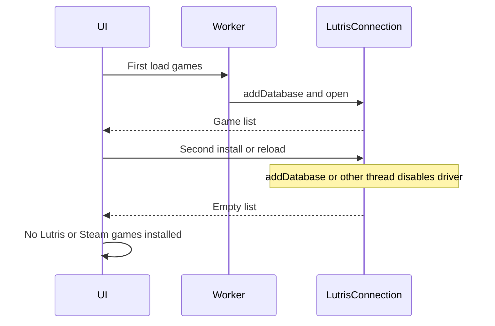

# Fix one-shot game selection

Date: 2026-11-03. Status: not started. This is the plan for a later pass. No `src/` changes have been made for it.

The first Lutris or Steam listing succeeds. The next install or tester load comes back empty, and the UI shows the "no games installed" dialogs in `src/qt_gui/plugin_install.cpp` (`No Lutris Games Found`, `No Steam Games Found`, `No Proton Games Found`) or the tester status `No games found` in `src/qt_gui/testing_section.cpp`.

A user can list a platform's games and install or test one title. Choosing another game in the same session fails with an error that no Lutris (or other platform) games are installed.

## Why the second query fails

`LutrisIntegration` keeps one process-wide connection named `LutrisConnection`.

- `openLutrisDatabase()` in `src/qt_gui/lutris_integration.cpp` always calls `QSqlDatabase::addDatabase(...)`. If that name already exists, Qt removes the old connection and, when `lutrisDb` still holds it, deletes the driver (`connection is still in use, all queries will cease to work`).
- `closeLutrisDatabase()` calls `removeDatabase` while `lutrisDb` is still alive. The install path makes this worse: the count check in `installLutrisWineBridge()` (`src/qt_gui/plugin_install.cpp`) keeps a local `QSqlDatabase` in scope across that close.
- The tester loads games with `QtConcurrent::run` (`loadGamesForPlatform()` in `src/qt_gui/testing_section.cpp`). A Qt SQL connection may only be used on the thread that opened it. The first load opens it on a pool thread; the next load, or a GUI-thread prefix lookup (`getCurrentGameSlug`, `TesterLauncher::getPrefixForGame`), gets an invalid database and an empty game list.
- `PluginInstall` and `TestingSection` each own a `LutrisIntegration`, but both use the same connection name, so one screen's open/close disables the other's connection.

Steam does not use SQLite. Its second empty list comes from the tester clearing the combo before the async scan finishes, then replacing the previous list with whatever that scan returns. A failed Lutris reload, or a scan that loses the race, leaves "No games found" for whichever platform was just selected.

## Changes

1. **Make the Lutris connection reusable** in `src/qt_gui/lutris_integration.cpp` and `src/qt_gui/lutris_integration.h`.
   - Give each `LutrisIntegration` its own connection name.
   - If that connection is already open on this thread, reuse it. Do not call `addDatabase` again.
   - In `closeLutrisDatabase`, close, set `lutrisDb = QSqlDatabase()`, then `removeDatabase`.
   - Remember the last successful `QList<LutrisGame>`. `getLutrisGames()` can serve that cache; a real refresh retries a clean open and, on failure, keeps the cache and sets `lastError` to the SQL error instead of pretending the library is empty.

2. **Stop the install dialog from clobbering the connection** in `src/qt_gui/plugin_install.cpp`.
   - Replace the local `QSqlDatabase` / `QSqlQuery` count check with a method on `LutrisIntegration`.
   - If a refresh fails and the cache is non-empty, show the cached games. If it fails and the cache is empty, show `lastError` (database open/query failure), not "Please install some games in Lutris first".

3. **Keep the tester list stable** in `src/qt_gui/testing_section.cpp`.
   - Run the Lutris query on the GUI thread (the SQL connection's thread). Steam manifest scanning can stay in the background, but it must not call into a live `QSqlDatabase`.
   - Do not `clear()` the game combo until a new load succeeds. If the new load fails, leave the previous games in place and show the error.
   - Resolve the selected game's prefix from the list already loaded (`currentGames` plus the cached `LutrisGame` / `SteamGame` records) instead of opening the database again from another thread in `getCurrentGameSlug`, `executeTester`, and `src/qt_gui/tester_launcher.cpp`.

4. **Steam second pass** in `src/qt_gui/steam_integration.cpp`: keep the last successful game list the same way, so a second Wine Bridge install or tester run does not replace a good catalog with an empty one when a rescan fails. A successful rescan that truly finds zero games can still update the list.

## Work items

1. Fix Lutris SQL connection lifetime, per-instance name, and last-good game cache.
2. Stop `plugin_install` from holding a second Lutris connection; surface real DB errors and reuse the cache.
3. Query Lutris on the GUI thread, keep the previous game combo on failure, and resolve prefixes from the loaded list.
4. Cache the last successful Steam game list so a failed rescan does not blank the picker.
