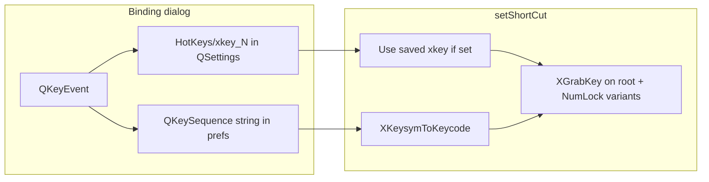

# Issue #69 — Technical assessment and next steps

**GitLab:** [Global Hotkeys Not Registering Inputs Correctly (#69)](https://gitlab.com/fwfa123/linuxtrackx-ir/-/work_items/69)  
**Related:** [ISSUE_69_HOTKEY_FIX_PLAN.md](./ISSUE_69_HOTKEY_FIX_PLAN.md) (code-review remediation on `main`)  
**Status (2026-10-23):** Fixes merged through `4ea5122` on `main`; verified on Debian Trixie; Fedora/Arch matrix pending  
**Changelog target:** [2.2.1] — xcb default, XInput2 raw keys, scan-code persistence, ungrab-before-dialog

---

## Weekend checklist

- [ ] **Fedora matrix** — Reproduce bind/fire on Fedora 44 GNOME (desktop/AppImage, external numpad, symbol keys `[]\;',./`-=`)
- [ ] **clear-xkey** — Clear `HotKeys/xkey_<id>` when hotkey set to `None` (`ltr_show.cpp` + `HotKey::setHotKey`)
- [ ] **release-221** — Publish 2.2.1 AppImage; ask reporter to re-bind after upgrade
- [ ] **error-plumb** (optional) — Surface XGrabKey/translation failure in the hotkey warning dialog

---

## What the reporter is seeing

Issue #69 has two intertwined problems:

1. **Numpad vs number row** — Binding numpad `2` (X keycode **88** in their log) but `XGrabKey` ends up on keycode **11** (main keyboard `2`). At runtime, the hotkey fires on the wrong physical key.
2. **Punctuation / symbols** — Keys like `=`, `[`, etc. show **“Couldn’t register new hotkey!”** from `src/mickey/hotkey.cpp` when `setShortCut()` returns false.

Their debug trace is a strong signal they were on **older hotkey code**, not current `main`:

- `Installing native event filter` — removed in `4df2ca5`; `main` uses an X11 **socket notifier** only (`src/mickey/keyb_x11.cpp`).
- `Created event window 0x3200001` — event-window path removed; grabs are on **root** only.
- Numpad press logged as keycode 88, grab on **11** — classic **`XKeysymToKeycode()` ambiguity** when Qt/`KeypadModifier` does not force `XK_KP_*`.

They tested **v2.2.0 AppImage** on **Fedora 44 + GNOME**. Changelog **[2.2.1]** documents the follow-up fixes (xcb default, XInput2 raw keys, scan-code persistence) that landed **after** the initial #69 fix (`370eb14`).

## Root causes (approaches map cleanly)

| Symptom | Underlying cause | Fix on `main` |
|--------|------------------|---------------|
| Numpad binds as number row | One keysym, many keycodes; translator picks arbitrary keycode | Persist **`nativeScanCode()`** in `src/mickey/my_line_edit.cpp`, prefer **`HotKeys/xkey_<id>`** in `setShortCut()` (`src/mickey/keyb_x11.cpp`) |
| Qt shows `2` not `NumPad 2` | Missing `KeypadModifier` on some devices/sessions | `qtKeyToXKeysym(..., fromKeypad)` + `hotkeyDisplayString()` (`src/mickey/hotkey_label.cpp`) when modifier present |
| Punctuation fails registration | Old path used `XStringToKeysym` on portable strings | Latin-1 / explicit keysym map in `qtKeyToXKeysym()` (`370eb14`) |
| Hotkeys dead under GNOME Wayland | Native Wayland Qt has no global X grabs | **`QT_QPA_PLATFORM=xcb`** in `src/linuxtrack.desktop` + AppImage `scripts/appimage/v2/common.sh` + `scripts/test/run_gui.sh` |
| Hotkeys dead in fullscreen games | `XGrabKeyboard` steals keys | **XI_RawKeyPress/Release** on root + dedup with grab events |
| Double-fire / compile break | Native event filter + missing `HKDBG` | Socket notifier only + `HKDBG` define (`4df2ca5`, review plan) |
| Dialog could not capture already-grabbed keys | Grab intercepts key before line edit | **Ungrab before dialog** (`4ea5122` in `src/mickey/hotkey.cpp`) |

**Verdict:** The issue is legitimate; the multi-commit strategy targets the right layers. Dave’s report is consistent with **2.2.0 (or partial fix) without re-bind**, not with a fully exercised **2.2.1 / current `main`** stack.

**Debian Trixie works** after building with xcb + scan-code path and re-binding in the UI.

## Remaining gaps (before closing #69)

These explain edge cases Dave might still hit on Fedora even after a release.

### 1. Stale `xkey_*` after Clear / None

`clearHotkeys()` in `src/qt_gui/ltr_show.cpp` sets `tracking_toggle` / `quick_recenter` to `None` but **does not remove** `HotKeys/xkey_0` / `xkey_1`. If a user clears and rebinds without opening the dialog path that overwrites xkey, **`setShortCut()` can resurrect an old physical keycode** while the displayed QKeySequence string changes.

**Recommendation:** On clear, unset binding, and when accepting a new keyboard binding, remove or overwrite matching `xkey_<hotKeyId>` keys. Same for Mickey if it shares the `ltr_gui` xkey store.

### 2. Upgrade path requires re-bind once

Prefs saved as `"2"` without `xkey_*` still use **Keysym fallback** on startup (`ltr_show.cpp` `showEvent`). External numpads stay wrong until the user **opens Assign and presses the key again** (so `my_line_edit` writes xkey).

**Recommendation:** Issue comment + release notes: “Re-bind global hotkeys once after 2.2.1.” Optional: migration that clears ambiguous keyboard hotkeys or detects KP keycode range on next bind only (avoid guessing at startup).

### 3. Mickey hotkey IDs vs GUI

- `ltr_gui`: recenter id **1** (`HOTKEY_QUICK_RECENTER`)
- Mickey: recenter id **3**

Both read/write `HotKeys/xkey_<id>` in **`linuxtrack/ltr_gui`** settings. That is consistent internally but **Mickey and GUI do not share xkey slots** for the same logical action. Not Dave’s main bug, but worth knowing when testing Mickey.

### 4. Opaque failure message

`setShortCut()` can fail for translation (`NoSymbol` / keycode 0), duplicate hash entry, or **`XGrabKey` BadAccess** (another client grabbed the key). The UI always shows the same string; `errMsg` in `src/mickey/keyb_x11.cpp` from the X error handler is never surfaced.

**Recommendation:** Plumb `errMsg` (or a short enum) into the QMessageBox for supportability on Fedora/GNOME.

### 5. Platform validation still pending

Dave: **Fedora 44, GNOME, external USB numpad, AppImage**. Verified so far: **Debian Trixie only**.

Fedora-specific risks to exercise:

- Launch via **menu / `.desktop`** (xcb) vs plain `ltr_gui` from a terminal without `QT_QPA_PLATFORM`
- **libXi / XInput2** present in runtime (build docs already stress this)
- Symbol keys that failed for Dave: `[]\;',./`-=` — bind, restart app, confirm grab and fire
- Numpad: confirm `~/.config/linuxtrack/ltr_gui.conf` (or platform equivalent) contains `HotKeys/xkey_1=<88>` (example) after bind

## Suggested closure path for GitLab

1. **Ship or point Dave to a build containing everything through `4ea5122`** (changelog **[2.2.1]**), not 2.2.0 AppImage alone.
2. Ask Dave to **Clear hotkeys → re-bind** each action (populates `xkey_*`).
3. Confirm launch path uses **xcb** (AppImage wrapper or desktop file).
4. Run the **Fedora/GNOME + external numpad** matrix; if anything fails, capture whether failure is at **bind** (translation/grab) or **fire** (hash lookup / raw vs grab).
5. If bind still fails for symbols on Fedora only, inspect **X error text** (implement gap #4 temporarily with `HKDBG` or QMessageBox detail).

## Optional code follow-ups (small, high leverage)

- Clear `HotKeys/xkey_<id>` when hotkey set to `None` (`HotKey::setHotKey` + `clearHotkeys`).
- Fix misleading log string still saying “Installing native event filter” in `setShortCut()` (cosmetic).
- Release **2.2.1 AppImage** with explicit #69 verification checklist in release notes.

No architectural pivot needed unless Fedora testing shows **`nativeScanCode() == 0`** in the bind dialog on XWayland — then add a fallback that classifies keycode via `XKeycodeToKeysym(display, code, 0)` vs `XKeycodeToKeysym(display, code, 1)` (group) to infer keypad even without Qt’s modifier.
