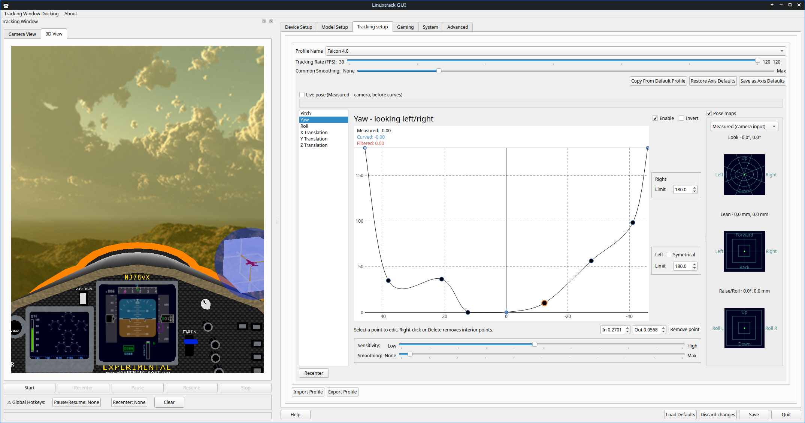

# LinuxTrack X-IR v3.0.0 Release Notes

**Release Date:** November 7, 2026  
**Branch:** `main`

---

> **Issues & support:** [gitlab.com/fwfa123/linuxtrackx-ir](https://gitlab.com/fwfa123/linuxtrackx-ir/-/issues) (primary). This GitHub repo is a mirror—**do not use bare `#NN` issue numbers** here; they may link to the wrong upstream project. Use [GitLab issues](https://gitlab.com/fwfa123/linuxtrackx-ir/-/issues) instead.
>
> **Canonical release notes:** [GitLab v3.0.0](https://gitlab.com/fwfa123/linuxtrackx-ir/-/releases/v3.0.0)

---

### Overview

**v3.0.0** is a major feature release after [v2.2.1](https://gitlab.com/fwfa123/linuxtrackx-ir/-/releases/v2.2.1). It introduces a **complete redesign of the Tracking Setup tab**: embedded curve control point editor, per-axis Enable/Invert toggles, Limits with Symmetrical option, and a vertical Pose maps sidebar—all in one unified view. The profile format has changed; see **Breaking Changes** below for required actions.



---

### ⚠️ Breaking Changes — Required Actions

#### Profile Format Change (Profiles Will NOT Load)

v3.0.0 uses a **new profile format** with embedded curve control points and pose-map data. **Previous profiles are incompatible.**

**You must delete your old linuxtrack configuration file from your home folder before using v3.0.0:**

```bash
rm ~/.config/linuxtrack/linuxtrack1.conf
```

After deletion, LinuxTrack X-IR will create a fresh config on first launch with the new format. You will need to reconfigure your device and recreate your axis curves.

#### Wine Bridge Reinstall Required for Curve Control Point Profiles

To use the **new editable curve control point profiles** in-game, you must reinstall the Wine bridge into every game prefix that needs it:

1. Open LinuxTrack X-IR → **Gaming Tab**
2. Select your target game/prefix
3. Click **"Install Wine Bridge"** (or re-install over the existing one)

The updated `NPClient.dll` now honors live axis curves and per-axis parameters sent from the GUI. Without reinstalling, games will use the old curve format and **will not receive control point edits**.

---

### Highlights

#### Embedded Curve Editor & Pose Maps (No More Separate Dialog)

The Detailed Axes Setup is now fully embedded in the Tracking Setup tab — no separate window needed:

- **Curve editor** with editable control points directly on the response graph
- **Per-axis Enable/Invert toggles** live on each curve page
- **Sensitivity & Smoothing sliders** per axis
- **Right/Left Limits** with Symmetrical checkbox for independent half-axis tuning
- **Point editing controls** — click a point to edit In/Out values; remove interior points via right-click, Delete key, or the Remove point button
- **Pose maps sidebar** (Look / Lean / Raise/Roll) stacked vertically beside the curve editor, expanded by default

#### New Profile Tab Layout

- Slim always-visible header with Tracking Rate and Common Smoothing
- Copy from Default Profile / Restore Axis Defaults / Save as Axis Defaults buttons in the header area
- Import / Export Profile buttons at the bottom of the tab
- Full scroll support on shorter displays

---

### Fixed (since v3.0.0)

| Commit | Description |
|--------|-------------|
| `f5c0139` | fix(gui): drop unused triangle counter in GLWidget::makeObjects |
| `306d269` | fix(wine_bridge): warn on weak TrackIR game-list matches (#33) |
| `01ace52` | fix(src): close local socket, preference, and device permission findings |
| `adc2d39` | fix(gui): keep a second game selectable in the same session |
| `36d09aa` | fix(gui): enlarge square pose maps with slimmer chrome |
| `49f3b99` | fix(gui): expand Pose maps by default on the Profile curves pane |
| `21583ce` | fix(gui): keep curve control points aligned when Invert is toggled |
| `f048c5c` | fix: simplify master queue and keep accepted sockets non-blocking |
| `ad9249b` | fix: harden IPC, permissions, and master/slave streaming |

---

### Docs and wiki

- Tracking setup help (`axes_setup.htm`) updated with new unified `Tracking-DetAxis.png` screenshot and numbered callout annotations (regions 1–11)
- GitHub and GitLab wikis updated for the embedded curves UI — removed old separate-dialog screenshots, added region descriptions
- Help sidebar grouped to match the main window layout

---

### Upgrade from v2.2.1

**Required steps:**

1. **Delete your old config:** `rm ~/.config/linuxtrack/linuxtrack1.conf`
2. Replace the AppImage with the new v3.0.0 build below — no Wine bridge reinstall needed for basic tracking, but see above for curve control point profiles in-game
3. Source: `git checkout v3.0.0`, clean `build/`, rebuild, `sudo cmake --install .`

---

### Quick start

```bash
chmod +x LinuxTrack-X-IR-v3.0.0-x86_64.AppImage
./LinuxTrack-X-IR-v3.0.0-x86_64.AppImage
```

---

### Build from source

```bash
git clone https://gitlab.com/fwfa123/linuxtrackx-ir.git
cd linuxtrackx-ir
git checkout v3.0.0
mkdir build && cd build
cmake .. -DCMAKE_INSTALL_PREFIX=/opt
cmake --build . -j"$(nproc)"
sudo cmake --install .
```

See [`docs/readme/`](https://gitlab.com/fwfa123/linuxtrackx-ir/-/tree/v3.0.0/docs/readme) on GitLab.

---

### Credits — Contributors & Issue Reporters

We want to thank everyone who helped make v3.0.0 possible:

**f.josef** — Multiple bug reports, testing, and code contributions throughout the 3.x development cycle  
**telephono / telephono1** — Issue reporting and testing feedback  
**James** — Testing support and community help  
**Mike** — Wine bridge testing and feedback  


### Special Thanks

- **[OpenTrack](https://github.com/opentrack/opentrack)** — The OpenTrack repository was instrumental in helping us design the curve control point interface. Thank you to the OpenTrack team and community for your excellent work on head tracking.

---

### Links

- **GitLab release (canonical):** https://gitlab.com/fwfa123/linuxtrackx-ir/-/releases/v3.0.0
- **CHANGELOG:** https://gitlab.com/fwfa123/linuxtrackx-ir/-/blob/v3.0.0/CHANGELOG.md
- **Wiki — Tracking setup (axes):** https://gitlab.com/fwfa123/linuxtrackx-ir/-/wikis/axes_setup
- **Wiki — Device setup:** https://gitlab.com/fwfa123/linuxtrackx-ir/-/wikis/dev_setup
- **Wiki — Gaming tab:** https://gitlab.com/fwfa123/linuxtrackx-ir/-/wikis/gaming_tab

---

*Thank you for using LinuxTrack X-IR!*
